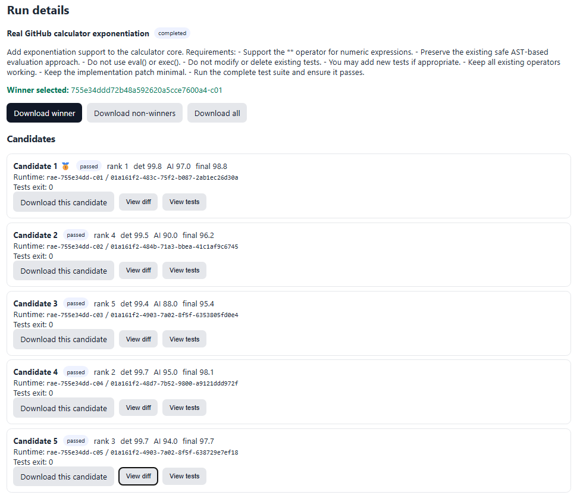
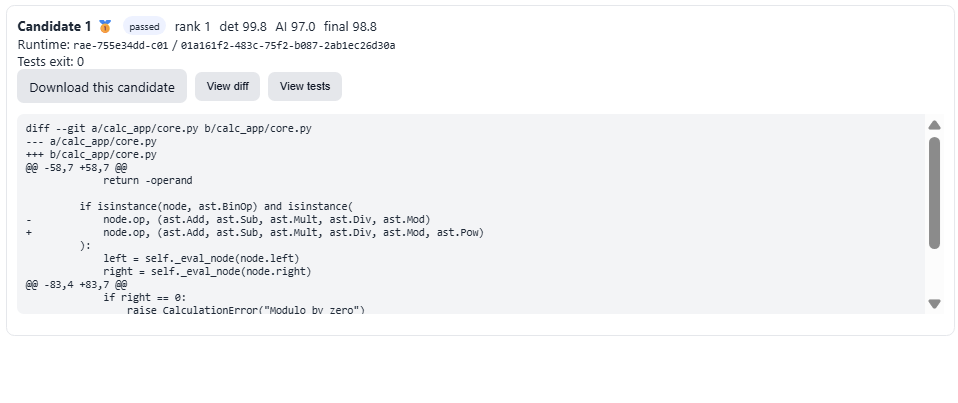
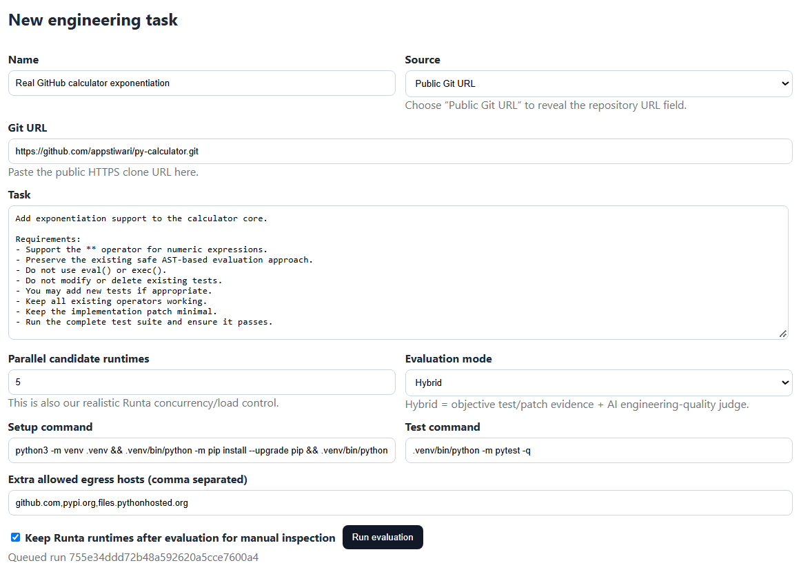

# Agentic Software Engineering Evaluation Platform

A parallel software-engineering agent platform that runs independent coding candidates in isolated **Runta runtimes**, evaluates them with deterministic test evidence and an optional AI judge, and selects the strongest acceptable implementation.

The project is designed around a simple question: **instead of trusting one coding-agent attempt, can we generate multiple isolated solutions from the same prepared repository state and rank them using objective correctness plus engineering-quality signals?**

> The current implementation was validated both on a controlled fixture and on a real public GitHub repository. In the final real-repository Hybrid run, five independent candidates all passed the repository test suite and were ranked using deterministic + AI evaluation.

<p align="center">
  
</p>

## What it demonstrates

- **Agentic software engineering** — autonomous inspect → edit → test → finish loops with persistent working context.
- **Parallel candidate search** — up to 12 independent coding strategies can run from a common checkpoint.
- **Runtime isolation** — each candidate executes in its own Runta runtime rather than sharing a mutable workspace.
- **Checkpoint fan-out** — repository setup is performed once, checkpointed, and reused as the common candidate starting point.
- **Deterministic evaluation** — passing the configured repository test command is a hard eligibility boundary.
- **AI engineering review** — an optional separate judge runtime compares correct candidates for patch quality, scope, and maintainability.
- **Hybrid ranking** — combines deterministic evidence and AI review while preventing a failing candidate from winning.
- **Governed model credentials** — the OpenAI credential is stored as a Runta tenant secret and injected into matching outbound requests instead of being copied into worker source or environment variables.
- **Public Git repository execution** — clone, setup, checkpoint, parallel agent execution, tests, diff generation, ranking, and artifact export.
- **Failure-aware orchestration** — explicit states for failed tests, agent errors, max-step termination, no-patch outcomes, and no acceptable winner.

## Product workflow

```text
Engineering task + repository
            |
            v
     Baseline Runta runtime
  clone/upload + setup + tests
            |
            v
       Runta checkpoint
            |
     +------+------+------+
     |      |      |      |
     v      v      v      v
 Candidate 1   Candidate 2   ... Candidate N
 Runta runtime Runta runtime     Runta runtime
     |            |                  |
     v            v                  v
 coding agent  coding agent      coding agent
 inspect/edit  inspect/edit      inspect/edit
 test/finish   test/finish       test/finish
     |            |                  |
     +------------+------------------+
                  |
                  v
        deterministic evidence
                  |
          +-------+-------+
          |               |
          v               v
  deterministic score   AI Judge
          |               |
          +-------+-------+
                  |
                  v
             Hybrid rank
                  |
                  v
               winner
                  |
                  v
      diff + tests + artifacts
```

The baseline runtime is prepared once. Candidate runtimes are restored from the same checkpoint so each agent starts from an equivalent repository state without repeating dependency setup for every candidate.

## Architecture

```text
Windows browser
      |
      | HTTP localhost:8000
      v
WSL2 / Linux control plane
+--------------------------------------------------------+
| FastAPI dashboard/API                                 |
| Orchestrator                                          |
| SQLite run/evidence store                             |
| Local scoring + artifact packaging                    |
+----------------------------+---------------------------+
                             |
                             | Runta API
                             v
Runta execution plane
+--------------------------------------------------------+
| Baseline runtime -> checkpoint                        |
|        |                                               |
|        +-> candidate runtime 1 -> coding worker        |
|        +-> candidate runtime 2 -> coding worker        |
|        +-> ...                                         |
|        +-> candidate runtime N -> coding worker        |
|                                                        |
| Optional separate judge runtime                       |
| Governed egress + tenant-secret credential injection  |
+--------------------------------------------------------+
```

See [docs/architecture.md](docs/architecture.md) for component responsibilities and data flow.

## Key engineering decisions

### Prepare once, fan out many

Repository clone/upload, dependency setup, and baseline validation happen in one runtime. A Runta checkpoint then becomes the common starting state for all candidates. This avoids repeating expensive setup work and makes candidate comparison fairer.

### Deterministic correctness is a hard gate

A candidate is eligible to win only when its configured test command exits with code `0`. AI scoring can differentiate engineering quality among candidates, but it cannot rescue a deterministically failing solution.

### No fake winner

If every candidate fails deterministic validation, the run ends with no acceptable winner rather than selecting the least-bad failure.

### Agent completion is verified, not trusted

The coding worker cannot succeed merely by emitting `finish`. The configured test command is rerun and must pass before completion is accepted.

### Candidate diversity is explicit

Candidates receive different engineering strategies: minimal root-cause, test-driven, specification-first, regression-focused, edge-case-focused, maintainability-focused, reviewer-style, and others. The goal is to produce meaningfully different solution paths rather than N identical retries.

### Source artifacts exclude disposable environments

Real repositories often create `.venv`, caches, Git metadata, `node_modules`, or symlinks that should not become candidate artifacts. The runtime creates a source-only ZIP snapshot that excludes those paths and symlinks before download. Local diffing then compares the immutable baseline snapshot with each final candidate snapshot.

### Secrets are injected at the network boundary

The local control plane stores the model credential in Runta's tenant secret store. Candidate and judge runtimes receive a secret configuration that injects an `Authorization` header only for matching OpenAI egress. The real key is not intentionally written into candidate files or ordinary environment variables.

## Evaluation model

The project supports three modes:

| Mode | Behavior |
| --- | --- |
| **Deterministic** | Requires passing tests; score starts at 100 and applies a small patch-scope penalty based on changed lines. |
| **AI Judge** | Runs a separate judge workload that reviews candidate evidence and assigns engineering-quality scores. |
| **Hybrid** | `65% deterministic + 35% AI Judge`; deterministic pass/fail remains the hard winner-eligibility boundary. |

The AI judge receives task text, test results, candidate status, deterministic score, strategy, and bounded diff/test evidence. It is instructed to penalize regressions, unrelated changes, unnecessary complexity, brittle fixes, task mismatch, and failed agent states.

See [docs/evaluation-and-ranking.md](docs/evaluation-and-ranking.md).

## Real repository validation

The final end-to-end validation used the public `appstiwari/py-calculator` repository with the task of adding exponentiation (`**`) support while preserving its restricted AST evaluation approach.

Five candidates were restored from the same checkpoint and evaluated in **Hybrid** mode:

| Candidate | Tests | Deterministic | AI Judge | Final | Rank |
| --- | ---: | ---: | ---: | ---: | ---: |
| Candidate 1 | PASS | 99.8 | 97.0 | **98.8** | **1** |
| Candidate 4 | PASS | 99.7 | 95.0 | 98.1 | 2 |
| Candidate 5 | PASS | 99.7 | 94.0 | 97.7 | 3 |
| Candidate 2 | PASS | 99.5 | 90.0 | 96.2 | 4 |
| Candidate 3 | PASS | 99.4 | 88.0 | 95.4 | 5 |

All five candidates exited the repository test suite with code `0`, while producing different implementation trade-offs around minimalism, documentation, exception handling, and complex-number behavior.

<p align="center">
  
</p>

The full validation notes are in [docs/real-repository-validation.md](docs/real-repository-validation.md).

## Runta capabilities exercised

The project or its included experiment harness has exercised:

- runtime creation, command execution, files, and persistence;
- checkpoints and checkpoint-based fan-out;
- concurrent runtime execution, including a 12-runtime fan-out experiment;
- egress allow/deny behavior;
- tenant secrets and runtime secret configuration;
- pause/resume and shutdown/boot lifecycle behavior;
- manual memory resizing and memory-limit experiments;
- ingress publishing;
- auto-suspend/wake experimentation;
- project-owned runtime/checkpoint cleanup.

See [docs/runta-integration.md](docs/runta-integration.md) and [docs/experiments-and-results.md](docs/experiments-and-results.md).

## Screenshots

### Real Git repository task configuration

<p align="center">
  
</p>

### Five-candidate Hybrid result

<p align="center">
  
</p>

## Tech stack

### Local control plane

- Python 3.10+
- FastAPI
- Uvicorn
- SQLite
- Pydantic
- `httpx`
- pytest / pytest-asyncio

### Execution and AI

- Runta Python SDK `0.2.5`
- Runta runtimes + checkpoints
- Runta egress governance
- Runta tenant secrets / runtime secret configuration
- OpenAI Responses-compatible endpoint

### UI

- Server-served HTML/CSS/JavaScript dashboard
- No frontend build step required

## Prerequisites

The project was developed and validated from Ubuntu under WSL2 on Windows. The local source tree and unit test suite are cross-platform, so they can also be inspected and tested from native Windows. The live Runta control plane should be run from Linux/WSL.

You need:

- Python 3.10+
- Git
- a Runta API token
- an OpenAI API key

## Quick start

### 1. Clone

```bash
git clone https://github.com/aryansolanki/Agentic-Software-Engineering-Evaluation-Platform.git
cd Agentic-Software-Engineering-Evaluation-Platform
```

### 2. Create the local environment

```bash
python3 -m venv .venv
source .venv/bin/activate
python -m pip install --upgrade pip
pip install -e ".[dev]"
```

### 3. Configure credentials

```bash
cp .env.example .env
```

Set at minimum:

```env
RUNTA_TOKEN=...
OPENAI_API_KEY=...
OPENAI_MODEL=gpt-5-mini
```

Never commit `.env`.

### 4. Verify local code

```bash
pytest -q
python -m compileall -q src
```

Current repository baseline: **28 tests passing**.

### 5. Verify Runta connectivity

```bash
runta-eval preflight
```

### 6. Start the dashboard

```bash
runta-eval serve
```

Open:

```text
http://localhost:8000
```

For a more detailed walkthrough, see [START_HERE.md](START_HERE.md).

## Running the controlled fixture

The repository includes a small intentionally buggy calculator fixture for deterministic end-to-end testing.

Recommended first run:

```text
Source: Built-in controlled fixture
Candidates: 1
Evaluation: Deterministic
Test command: python3 -m unittest -v
Keep runtimes: ON
```

After that succeeds, try multiple candidates and Hybrid evaluation.

## Running a public Git repository

Select **Public Git URL** in the dashboard and provide:

- public HTTPS clone URL;
- engineering task;
- candidate count;
- setup command, if needed;
- repository-specific test command;
- additional egress hosts needed for package installation.

For Debian/Ubuntu repositories that need pip dependencies, prefer a repository-local virtual environment, for example:

```bash
python3 -m venv .venv && \
.venv/bin/python -m pip install --upgrade pip && \
.venv/bin/python -m pip install -r requirements-dev.txt
```

Then test with the same environment:

```bash
.venv/bin/python -m pytest -q
```

## Tests

```bash
pytest -q
```

The current suite covers, among other things:

- persistent agent working history;
- tolerant action parsing;
- loop prevention;
- finish/test validation;
- candidate strategy assignment;
- deterministic and Hybrid ranking;
- no-winner semantics;
- AI judge normalization;
- secret-configuration payloads;
- baseline/candidate diff generation;
- source snapshot filtering and safe extraction;
- export behavior and API models.

## Repository layout

```text
.
├── docs/
│   ├── images/
│   ├── architecture.md
│   ├── agent-design.md
│   ├── evaluation-and-ranking.md
│   ├── experiments-and-results.md
│   ├── production-tradeoffs.md
│   ├── real-repository-validation.md
│   ├── roadmap.md
│   ├── runta-integration.md
│   ├── security-and-secrets.md
│   └── troubleshooting.md
├── experiments/              # generated local experiment output (ignored)
├── fixtures/
│   └── buggy_calc/
├── scripts/
├── src/runta_agent_eval/
│   ├── api/
│   ├── core/
│   ├── runta/
│   ├── services/
│   ├── static/
│   └── workers/
├── tests/
├── .env.example
├── .gitignore
├── CHANGELOG.md
├── pyproject.toml
├── README.md
└── START_HERE.md
```

## Failure handling

The orchestration layer distinguishes between:

- candidate creation failure;
- agent error;
- max-step termination;
- failed tests;
- no meaningful patch;
- passing candidate with agent warning;
- successful candidate;
- AI judge failure with deterministic fallback;
- all candidates failing, which produces no winner.

This prevents infrastructure or model failures from being silently presented as successful engineering outcomes.

## Production-minded trade-offs

This is a portfolio/research-grade orchestration system, not a hosted multi-tenant SaaS product. The current implementation deliberately prioritizes the execution/evaluation problem over product infrastructure.

Not included in the present scope:

- user authentication / organization isolation;
- persistent distributed job queues;
- cancellation and retry orchestration;
- live token/cost accounting;
- GitHub App installation and PR creation;
- private repository credentials;
- streaming WebSocket agent logs;
- enterprise observability and audit infrastructure;
- sandbox policy customization beyond the demonstrated Runta controls.

See [docs/production-tradeoffs.md](docs/production-tradeoffs.md) and [docs/roadmap.md](docs/roadmap.md).

## Documentation

- [Getting started](START_HERE.md)
- [Architecture](docs/architecture.md)
- [Agent design](docs/agent-design.md)
- [Runta integration](docs/runta-integration.md)
- [Evaluation and ranking](docs/evaluation-and-ranking.md)
- [Security and secrets](docs/security-and-secrets.md)
- [Experiments and results](docs/experiments-and-results.md)
- [Real repository validation](docs/real-repository-validation.md)
- [Troubleshooting](docs/troubleshooting.md)
- [Production trade-offs](docs/production-tradeoffs.md)
- [Roadmap](docs/roadmap.md)
- [Learning guide](docs/learning-guide.md)
